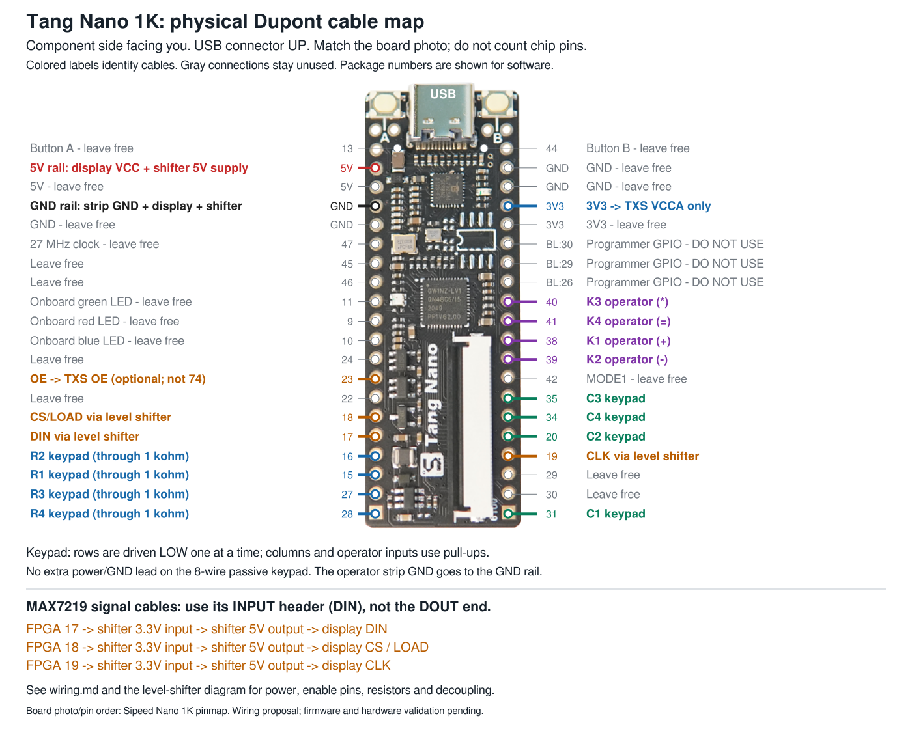
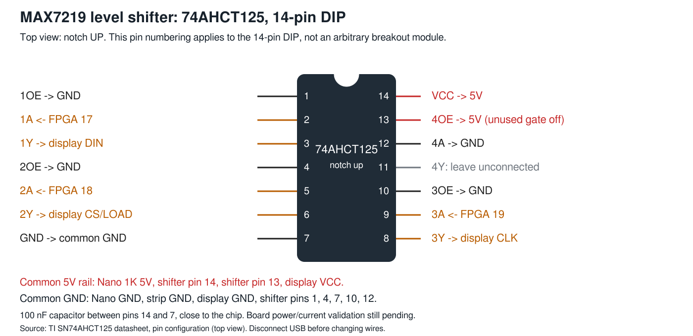
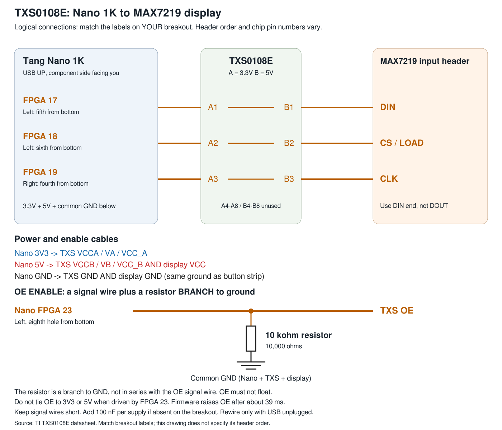

# Dupont wiring map

Hold the Nano 1K with its component side facing you and USB connector
at the top. The diagram uses Sipeed's board photo and header order;
colored lines end at the actual holes. Gray labels stay unused.
Disconnect USB before adding or moving cables. The calculator firmware is modeled, simulated and routed; physical
peripheral operation still needs the first wired test. See calculator-test.md.

[Editable board SVG](images/dupont-board.svg).
Open SVG in a browser or Inkscape; PNG works in any image viewer.
Colors group signals; your actual wire colors may differ.

## Each peripheral cable

These numbers are FPGA package pin names, not header-position counts.
The physical locations are shown in the photo above. All counts below
start at the bottom of the board, with USB still at the top.

| Cable | FPGA pin | Physical hole |
| ----- | -------- | ------------- |
| Keypad R1 | 15 | Left, third from bottom, through 1 kohm series resistor |
| Keypad R2 | 16 | Left, fourth from bottom, through 1 kohm series resistor |
| Keypad R3 | 27 | Left, second from bottom, through 1 kohm series resistor |
| Keypad R4 | 28 | Left, bottom hole, through 1 kohm series resistor |
| Keypad C1 | 31 | Right, bottom hole |
| Keypad C2 | 20 | Right, fifth from bottom |
| Keypad C3 | 35 | Right, seventh from bottom |
| Keypad C4 | 34 | Right, sixth from bottom |
| Strip K1 (+) | 38 | Right, tenth from bottom |
| Strip K2 (-) | 39 | Right, ninth from bottom |
| Strip K3 (*) | 40 | Right, twelfth from bottom |
| Strip K4 (=) | 41 | Right, eleventh from bottom |
| TXS0108E OE (optional variant) | 23 | Left, eighth from bottom; 10 kohm from OE to GND |
| Strip GND | GND | Left GND shown in black; fan out to a common ground rail |
| Display DIN input | 17 via level shifter | Left, fifth from bottom -> shifter DIN channel -> display DIN |
| Display CS/LOAD | 18 via level shifter | Left, sixth from bottom -> shifter CS channel -> display CS |
| Display CLK | 19 via level shifter | Right, fourth from bottom -> shifter CLK channel -> display CLK |
| Display VCC | 5V | Left red 5V hole in diagram -> common 5V rail |
| Display GND | GND | Common ground rail |

The passive keypad has only its eight row/column leads, with no extra
power or ground lead. The four-button strip has its own GND lead.
Rows are scanned low, inactive rows high impedance; columns and strip
inputs use pull-ups in the FPGA constraints. Verify the keypad's R1/C1
connector order with a continuity meter: C should connect R1 to C1.

## Display level shifter

This is a 74AHCT125 in a **14-pin DIP**, notch at the top, as seen
from above. A breakout board may label its terminals differently;
match the channel names, not its physical connector order.

[Editable level-shifter SVG](images/level-shifter.svg).

Use a breadboard or distribution block for the shared 5V and GND rails:
a single Dupont pin cannot accept all the required returns.
Ground shifter pins 1, 4, 7, 10 and 12. Connect pins 13 and 14 to 5V.
Leave pin 11 unconnected. Put a 100 nF capacitor between pins 14 and 7
close to the chip. Use the display's input connector labeled DIN;
DOUT is for another display, not the FPGA connection.

The displayed power plan uses the board's USB 5V rail for the shifter
and display. Confirm the USB supply, board path and module current
before powering the assembled system. Do not add an independent 5V
source while USB is attached. No 5V logic output returns to the FPGA.

## TXS0108E breakout alternative

A TXS0108E can replace the 74AHCT125 for the same three display signals.
Use A1-A3 on the 3.3V side and B1-B3 on the 5V side. Its OE is active
HIGH, unlike the 74AHCT125's individual active-low enables.

[Editable TXS0108E SVG](images/txs0108e-wiring.svg).
This is a logical connection diagram, not a specific breakout's header
layout. Match printed labels on your module. VCCA goes to Nano 3V3;
VCCB and display VCC go to 5V; all grounds join.

**OE must not be left unconnected.** The 10 kohm resistor is a branch
from the OE signal to ground, not a series resistor in the signal wire.
It holds OE low before the FPGA starts; FPGA pin 23 then drives OE high.
The missing resistor alone does not explain a persistently blank display
if OE is already driven high. Check the OE connection and voltage.

The calculator now drives TXS0108E OE from **FPGA package pin 23**,
left eighth hole from the bottom. Add a 10 kohm pull-down from OE to
GND; the FPGA enables it after about 39 ms. **Remove the old OE-to-3V3
jumper**: do not tie a driven OE signal to either power rail. This
replaces the earlier manual-jumper instruction. Keep signal cables short
and add 100 nF bypass capacitors per supply if absent from the breakout.

The SPI pins remain 17 (DIN), 18 (CS) and 19 (CLK). Use
hex1000-txs0108e.net for this variant. hex1000.net and the DIP diagram
remain the 74AHCT125 variant, where pin 23 is left unconnected. Do not
combine the two shifters. The same calculator image supports both.

## Corrections made while locating physical holes

Package pins 25/26 are power/ground, already replaced by 15/16 for R1/R2.
Pins 32/33 are not shown on the side headers in Sipeed's pinmap, despite
being valid FPGA I/O. C2/C3 now use header-accessible pins 20/35.
All 15 base peripheral FPGA assignments are unique and on the side
headers; the TXS variant adds OE on the otherwise free pin 23.
The BL:30, BL:29 and BL:26 labels are programmer MCU GPIO; leave them
unused. They are different from the FPGA pins with the same numbers.

The diagrams and hex1000.net now agree. The front-panel driver and calculator constraints now use this map.
Configuration-pin GPIO release and routed timing pass for the complete
calculator. The assembled hardware still needs the first wired test.

## Sources and regeneration

- [TI TXS0108E datasheet (power, OE and short-trace guidance)](https://www.ti.com/lit/ds/symlink/txs0108e.pdf)

- [Sipeed Nano 1K pinmap (board photo and header order)](https://en.wiki.sipeed.com/hardware/en/tang/Tang-Nano-1K/assets/1k-pin.png)
- [TI SN74AHCT125 datasheet (14-pin top view, pages 3-4)](https://www.ti.com/lit/ds/symlink/sn74ahct125.pdf)

The original Sipeed pinmap is retained in images/sipeed-tangnano1k-pinmap.png
with its labels and attribution here. The wiring overlays are this
project's additions. Regenerate using `just wiring-diagram`; its script
reads hex1000.net and rejects duplicate pins or assignments absent from
the documented side headers. PNG rendering uses rsvg-convert when on
PATH; SVG generation needs only Python 3.
